<p align="center">
  
</p>

<p align="center">
  <b>Una interfaz estilo Netflix para Android TV y móviles Android, basada en <a href="https://github.com/NuvioMedia/NuvioTV">NuvioTV</a> y <a href="https://github.com/NuvioMedia/NuvioMobile">NuvioMobile</a>.</b>
</p>

<p align="center">
  <a href="https://github.com/DaoeZ/notflix/releases/latest"></a>
  <a href="LICENSE"></a>
  
  
</p>

<p align="center">
  <a href="README.md">English</a> · <b>Español</b>
</p>

<p align="center">
  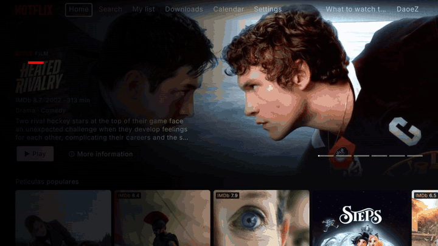
</p>

Notflix es una capa visual hecha por fans para Nuvio. Conserva todo lo que hace Nuvio (complementos de Stremio, perfiles, sincronización de cuenta, servicios debrid, subtítulos, reproductores) y le pone encima una interfaz de cine. En la tele está pensada para el mando: banner animado, tarjetas que crecen y reproducen el tráiler y fichas a pantalla completa. En el móvil está pensada para el dedo. En los dos, la reproducción automática te elige una fuente que funcione.

> [!IMPORTANT]
> Notflix **no aloja, indexa ni distribuye contenido**. Solo muestra lo que devuelven los complementos y servicios que configures. Es un proyecto independiente de fans, **sin relación con ningún servicio de streaming**, y no es una versión oficial de Nuvio.

## Novedades de la 1.0

- **Android TV sale de beta.** Es más rápida y trae nuevos controles del reproductor que puedes ordenar, Ajustes rediseñados, reproducción automática más lista por idioma, y pósters y tráileres en tu idioma. Ahora también hay descargas en la tele.
- **Se estrena la app para móviles Android.** Tiene el mismo estilo de Notflix, pensado para el dedo, con descargas, *Enviar a la TV* y sincronización con la app de la tele.
- **iPhone** llegará más adelante.

Lista completa en las [notas de la versión 1.0](https://github.com/DaoeZ/notflix/releases/latest).

## Capturas

### Android TV

| | |
|:---:|:---:|
| 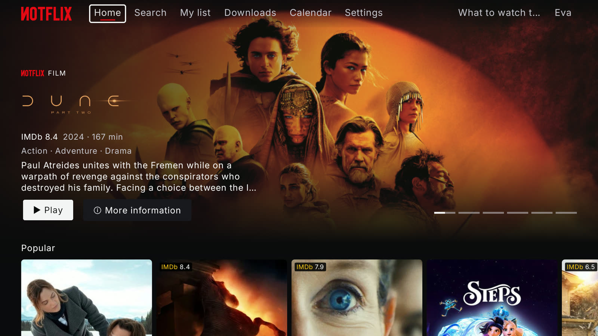 | 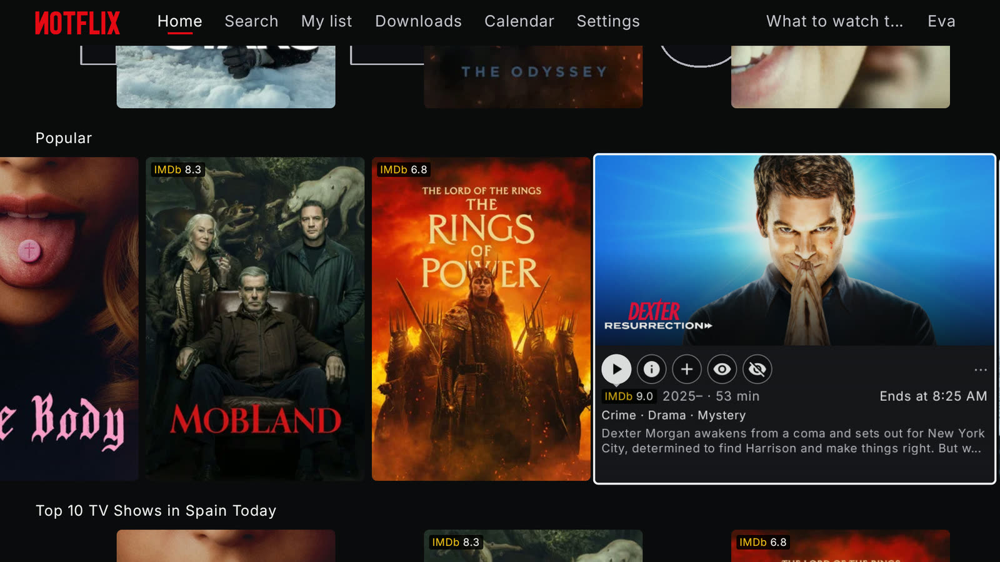 |
| Inicio | Te paras en un título y su tarjeta se abre |
| 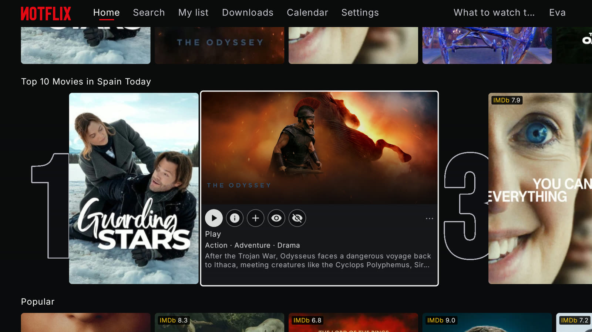 | 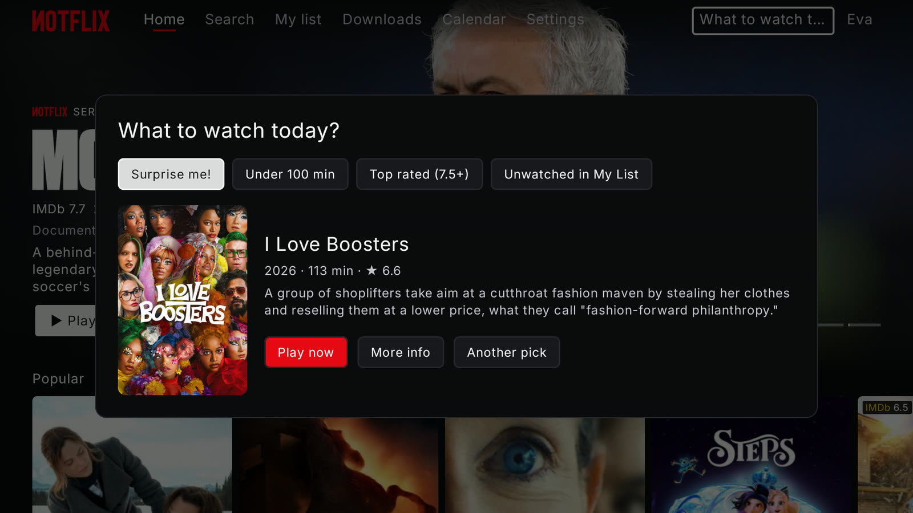 |
| El Top 10 de tu país hoy | ¿No sabes qué ver? Elige por ti |
| 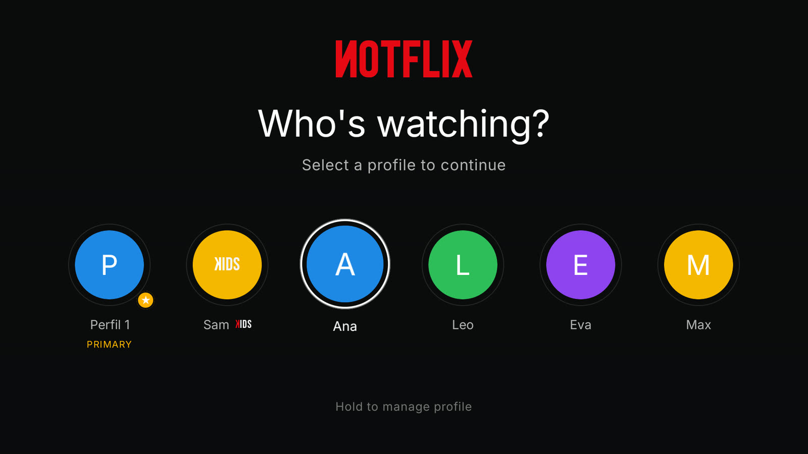 | 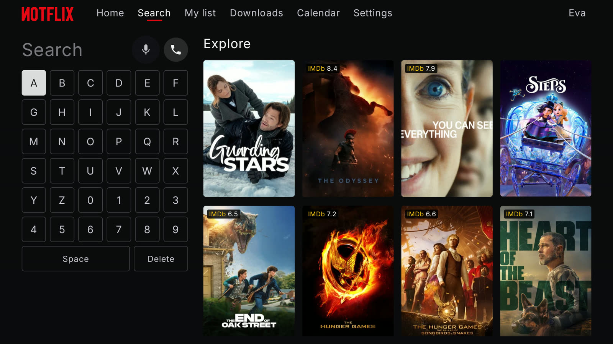 |
| Perfiles, también KIDS | Busca, o escríbelo desde el móvil |

### Móviles Android

| Inicio | Ficha | ¿Qué veo hoy? | Descargas | KIDS |
|:---:|:---:|:---:|:---:|:---:|
| 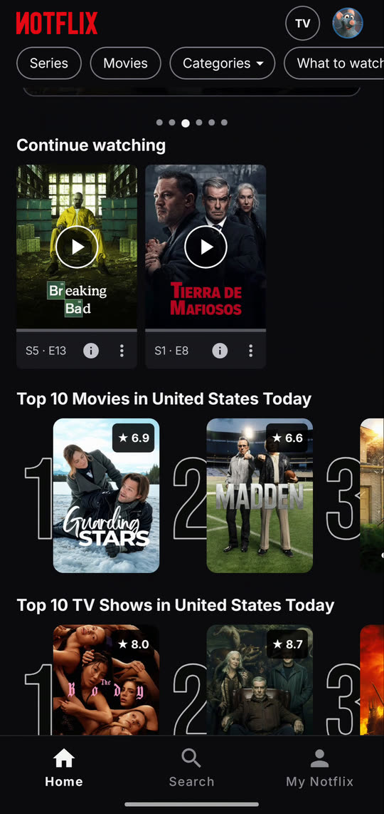 | 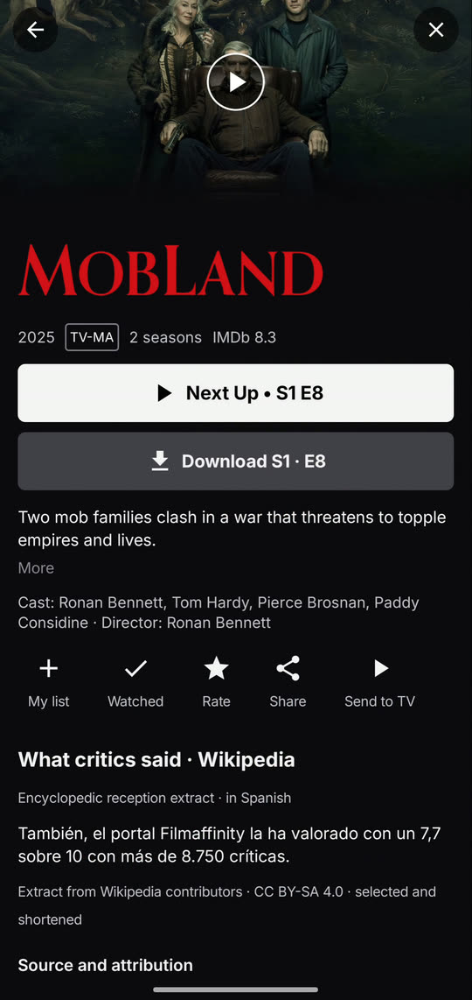 | 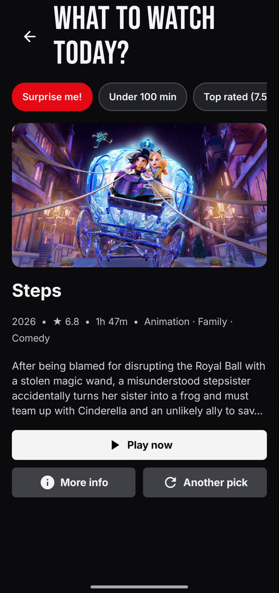 | 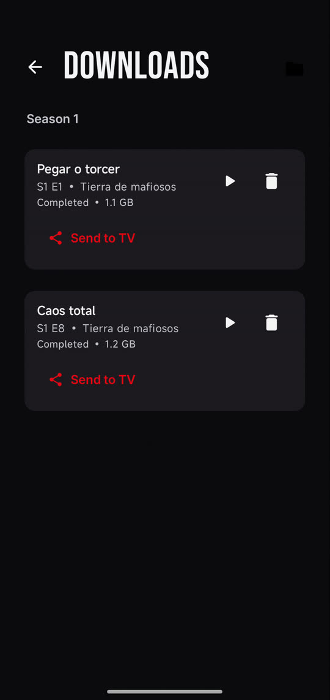 | 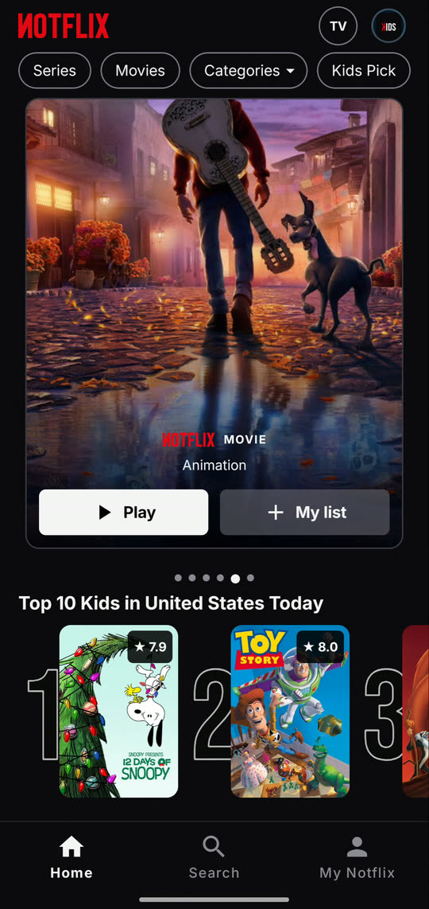 |

## Funciones

### Android TV

- **Un Inicio para el sofá.** Banner rotativo con el logo del título, filas listas para usar (populares, novedades, géneros, actores, directores, estudios), *Top 10 de tu país hoy*, *Mi lista*, *Porque viste*, una fila de *Esta semana* y notas que indican si son de IMDb o de TMDB.
- **¿Qué veo hoy?** Pulsa el botón de Inicio (o Menú en el mando) y elige menos de 100 minutos, para dormir, mejor valoradas, sin ver de Mi lista, animación o *¡Sorpréndeme!*. También hay versión infantil.
- **Tarjetas con vida.** Al pararte en un título, su tarjeta crece, reproduce el tráiler y muestra nota, año, duración, hora de fin, géneros y sinopsis. Desde la propia tarjeta puedes reproducir, abrir la ficha, añadir a Mi lista, marcar como visto, silenciar u ocultar. Tú eliges el tamaño de las tarjetas y lo rápido que se abren.
- **Fichas a pantalla completa** con fondo, logo, reparto, temporadas, episodios, tráileres y resumen de la temporada, y un botón *Descargar* junto a *Reproducir*.
- **Reproductor pensado para el mando.** Botones con icono y nombre (Audio y subtítulos, Episodios, Siguiente episodio, Velocidad, Más), ±10 s y barra roja. Elige qué botones salen y en qué orden. El **modo noche** aclara los diálogos y suaviza las escenas fuertes, y el **temporizador para dormir** para la reproducción tras un tiempo o al acabar el episodio. Puedes usar ExoPlayer o mpv.
- **El móvil como mando.** Escanea el QR de Buscar para escribir búsquedas, controlar la reproducción o mandar un título desde el móvil, todo por la red de casa.
- **Reproducción automática inteligente.** Ordena tus complementos, calidades e idiomas de audio, y decide si manda la calidad o el idioma. Reconoce las etiquetas de audio en 35 idiomas y arranca con la pista de audio que coincidió. Al volver a un título, reutiliza durante 7 días el último enlace que funcionó.
- **Perfiles para toda la casa.** Los perfiles **KIDS** tienen su propio Inicio y solo ven títulos dentro de su límite de edad. Si el perfil principal tiene PIN, nadie puede cambiar ese límite sin él.
- **En tu idioma.** La interfaz está en 36 idiomas, y los títulos, sinopsis, pósters y tráileres siguen el idioma de la app gracias a TMDB, con el inglés de respaldo.
- **Descargas.** Descarga una peli o un episodio en la tele, o recíbelo desde la app del móvil escaneando un QR, y míralo sin internet.
- **Y más:** calendario de próximos episodios con *Avísame*, saltar intro con IntroDB, Trakt y Simkl con un código, modo ambiente, intro y sonidos propios, y actualizaciones desde la app. Puedes volver al aspecto original de Nuvio cuando quieras en *Ajustes → Apariencia*.

### Móviles Android

- **El estilo de Notflix, pensado para el dedo.** Banner rotativo, las mismas filas que en la tele (también el Top 10 de tu país), *¿Qué veo hoy?* y fichas con logo, tráiler, temporadas, episodios, resumen de la temporada anterior (desde la segunda) y críticas de Wikipedia.
- **Descargas** desde fuentes compatibles, también temporadas enteras, con *Solo Wi-Fi* activado de serie. Las **Descargas inteligentes** borran los episodios vistos y ponen en cola el siguiente, dentro de un límite de espacio. **Enviar a la TV** copia una descarga terminada a la app de la tele.
- **Mando y teclado de la tele** desde el móvil, y mandar un título o episodio a la tele.
- **Reproductor** con botones con nombre y personalizables, modo noche, temporizador para dormir, *¿Sigues viendo?* y recomendaciones al terminar.
- **Se sincroniza con la tele.** Con la misma cuenta de Nuvio se comparten perfiles, biblioteca, progreso, títulos ocultos, límites de edad, ajustes de Notflix y Trakt.
- **Las mismas reglas que en la tele**: perfiles KIDS, títulos ocultos, reproducción automática por prioridad, calendario de estrenos con *Avísame* y *Novedades* tras cada actualización.
- **Actualizaciones desde la app** con las versiones de este repositorio.

## Instalación

Notflix necesita **Android 7.0 o superior**. Las dos apps se instalan junto a las apps oficiales de Nuvio, sin sustituirlas.

### Android TV

Para Android TV, Google TV, Fire TV y la mayoría de cajas Android. Si ya tienes Notflix, la propia app te ofrece la actualización.

| Tu aparato | APK | Código de Downloader |
|---|---|---|
| La mayoría de teles y sticks (Xiaomi, Fire TV, Chromecast con Google TV…) | [ARM32](https://github.com/DaoeZ/notflix/releases/latest/download/Notflix-armeabi-v7a.apk) | `6378067` |
| Cajas recientes de 64 bits (Nvidia Shield, Google TV más nuevos…) | [ARM64](https://github.com/DaoeZ/notflix/releases/latest/download/Notflix-arm64-v8a.apk) | `8264266` |
| Si no lo sabes | [Universal](https://github.com/DaoeZ/notflix/releases/latest/download/Notflix-universal.apk) (descarga más grande) | `3774482` |

**Con la app Downloader:** ábrela, escribe el código e instala el APK. Si la tele lo pide, permite que Downloader instale apps desconocidas.

**Con ADB**, desde un ordenador en la misma red:

```bash
adb connect <ip-de-la-tele>
adb install Notflix-armeabi-v7a.apk
```

### Móviles Android

Abre la [última versión](https://github.com/DaoeZ/notflix/releases/latest) en el móvil y descarga el APK de móvil. La mayoría de móviles necesitan `Notflix-Mobile-arm64.apk`. Si el móvil lo pide, permite que el navegador instale apps.

> La app de TV no está hecha para móviles, ni la de móvil para teles. Instala la que toca en cada aparato.

## Primeros pasos

1. Inicia sesión con una cuenta de Nuvio escaneando el QR, o elige *Continuar sin cuenta*. Con cuenta, tus complementos, perfiles, biblioteca y progreso aparecen en todos tus aparatos. Si usas Stremio, en r/StremioEnEspanol, r/NuvioAddons y r/StremioAddons hay guías para pasar tu cuenta a Nuvio.
2. Crea un perfil para cada persona, y un perfil KIDS para los peques.
3. Opcional: conecta Trakt o Simkl con un código en *Ajustes → Cuentas conectadas*. Ahí también puedes poner tu propia clave de TMDB, que tiene prioridad sobre la integrada.

## Compilar desde el código

Necesitas un JDK 21 y el SDK de Android (Android Studio trae los dos).

```bash
git clone https://github.com/DaoeZ/notflix.git
cd notflix
CI_USE_DEBUG_SIGNING=true ./gradlew :app:assembleFullRelease
```

Los APK quedan en `app/build/outputs/apk/full/release/`. Van firmados con tu clave local de depuración, así que no se pueden instalar como actualización encima de las versiones oficiales. Si no tienes `ANDROID_HOME`, pon `sdk.dir=<ruta al SDK de Android>` en `local.properties`. Añade `-PnotflixGithubOwner=<propietario> -PnotflixGithubRepo=<repo>` para que las actualizaciones de la app apunten a tu fork. Las compilaciones desde el código no llevan claves de servicios integradas, así que pon tu propia clave de TMDB dentro de la app.

## Privacidad

Notflix no tiene anuncios, ni analíticas, ni rastreo. Lee la [política de privacidad](PRIVACY.md) para ver con qué servicios habla la app y qué se queda en tu aparato.

## Comentarios

¿Has encontrado un fallo o tienes una idea? Abre un [issue](https://github.com/DaoeZ/notflix/issues/new/choose) o escribe en [r/NotflixTV](https://www.reddit.com/r/NotflixTV/). Antes de mandar un pull request, lee [CONTRIBUTING](CONTRIBUTING.md).

## Créditos

- **[NuvioTV](https://github.com/NuvioMedia/NuvioTV)** y **[NuvioMobile](https://github.com/NuvioMedia/NuvioMobile)** (GPL-3.0): las apps sobre las que está hecho Notflix. El motor, los complementos y la reproducción son suyos.
- **Bebas Neue**, de Dharma Type, con licencia SIL Open Font License 1.1.
- Metadatos e imágenes: [TMDB](https://www.themoviedb.org/) y los complementos de cada usuario. Este producto usa la API de TMDB, pero TMDB no lo respalda ni lo certifica.
- Historial, scrobbling y calendario: [Trakt](https://trakt.tv/). Notflix usa Trakt, pero Trakt no lo respalda ni lo certifica.
- Avisos completos de terceros en [`NOTICE.txt`](app/src/main/assets/notflix/NOTICE.txt).

## Licencia

[GNU General Public License v3.0](LICENSE), la misma que Nuvio.
