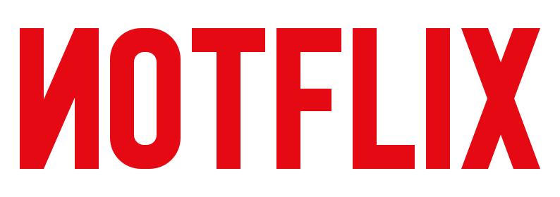
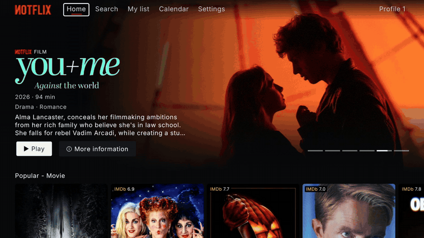
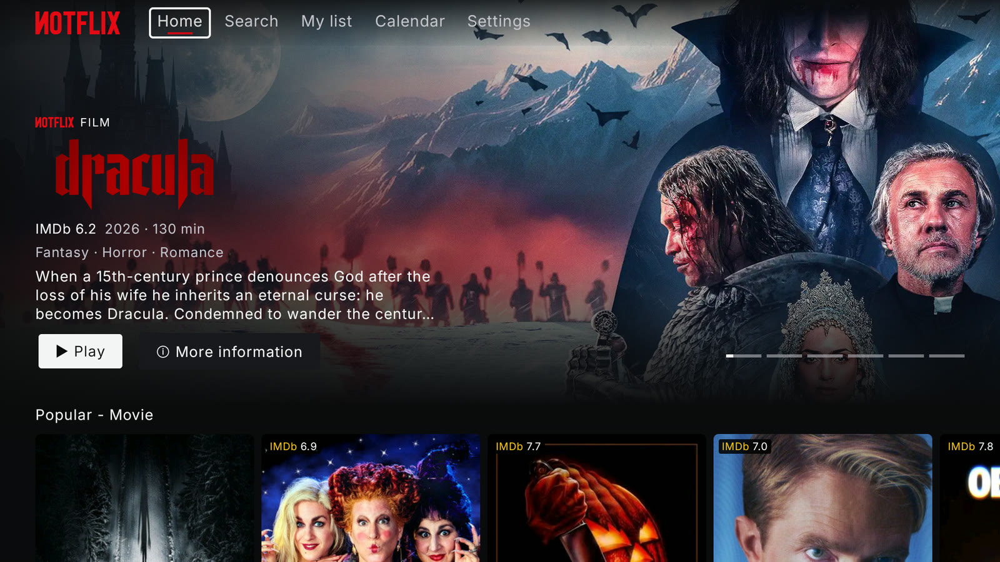
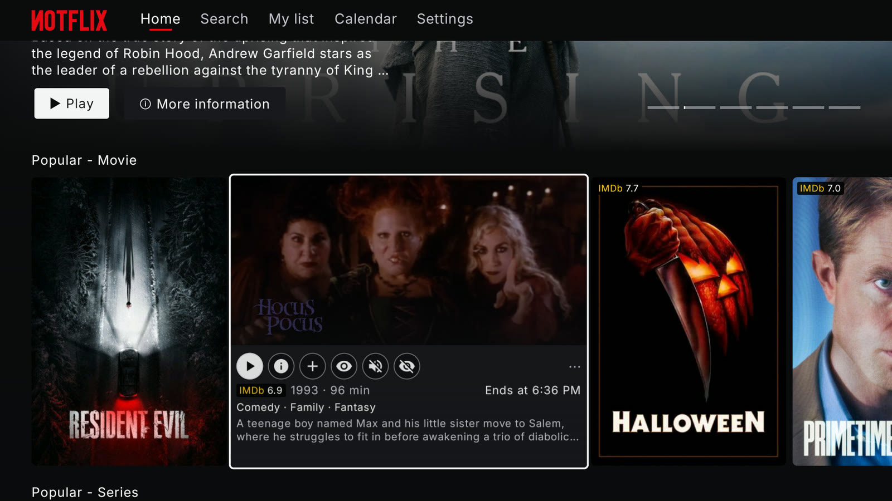
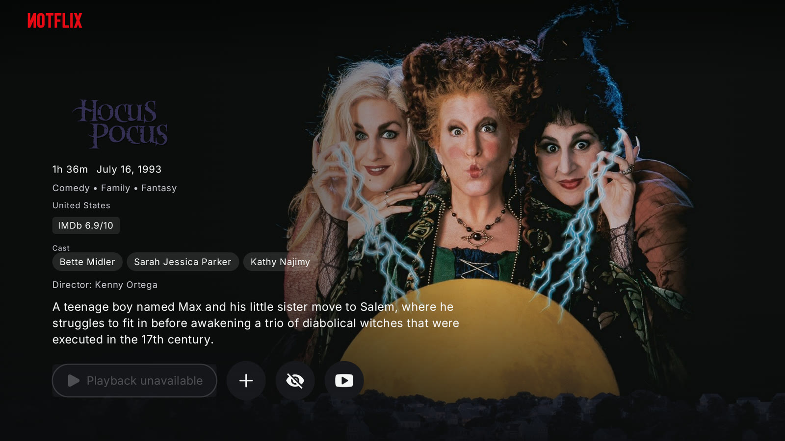
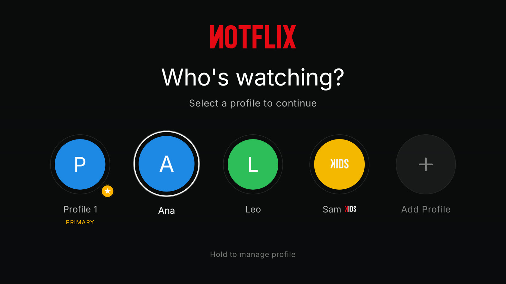
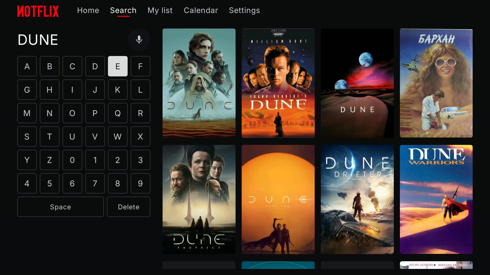
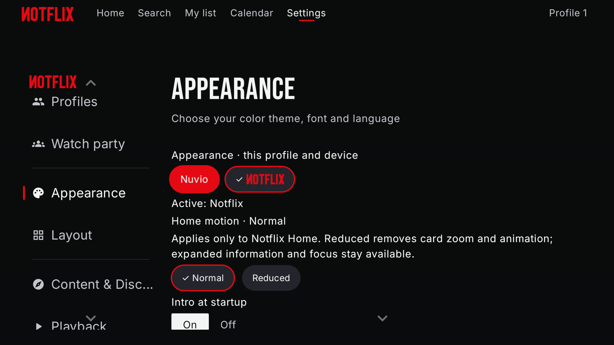

<p align="center">
  
</p>

<p align="center">
  <b>Una interfaz para Android TV pensada para la pantalla grande y el mando, construida sobre <a href="https://github.com/NuvioMedia/NuvioTV">NuvioTV</a>.</b>
</p>

<p align="center">
  <a href="https://github.com/DaoeZ/notflix/releases/latest"></a>
  <a href="LICENSE"></a>
  
</p>

<p align="center">
  <a href="README.md">English</a> · <b>Español</b>
</p>

<p align="center">
  
</p>

Notflix es una capa de presentación hecha por fans para NuvioTV. Conserva todo lo que hace Nuvio (complementos de Stremio, perfiles, sincronización de cuenta, servicios debrid, subtítulos, reproductores) y le pone encima una interfaz cinematográfica pensada para el mando: portada animada, tarjetas que crecen y reproducen el tráiler, fichas a pantalla completa y reproducción automática que elige por ti una fuente que funcione.

> [!IMPORTANT]
> Notflix **no aloja, indexa ni distribuye contenido**. Solo muestra lo que devuelven los complementos y servicios que configuras tú. Es un proyecto independiente hecho por fans, **sin relación con ningún servicio de streaming**, y no es una versión oficial de NuvioTV.

## Capturas

| | |
|:---:|:---:|
|  |  |
| Inicio | Las tarjetas crecen y reproducen el tráiler |
|  |  |
| Fichas a pantalla completa | Perfiles, también KIDS |
|  |  |
| Búsqueda pensada para el mando | Cambia entre Nuvio y Notflix cuando quieras |

## Funciones

- **Un Inicio hecho para el sofá.** Portada animada con el logotipo del título, filas listas para usar (populares, novedades, géneros, actores, directores, estudios) y nota de IMDb en cada tarjeta.
- **Tarjetas que cobran vida.** Al detenerte en un título, la tarjeta crece, reproduce el tráiler y muestra nota, año, duración, hora de fin, géneros y sinopsis. Acciones rápidas: reproducir, ficha, añadir a Mi lista, marcar como visto y silenciar.
- **Fichas a pantalla completa.** Fondo, logotipo, reparto, director, valoraciones y reanudar donde lo dejaste.
- **Perfiles para toda la casa.** Crea, edita y elige perfiles con el estilo de Notflix. Los perfiles **KIDS** solo ven títulos dentro de su límite de edad; si el perfil principal tiene PIN, nadie puede cambiar ese límite sin él.
- **Reproducción automática inteligente.** Lista de prioridad de complementos y calidades, con filtros *solo en caché* y *solo audio en español*. Si vuelves a un título, usa durante 7 días el último enlace que funcionó.
- **Claves desde el móvil.** Escanea un código QR y escribe tu clave de TMDB o tu Client ID de Trakt con el teclado del teléfono.
- **Calendario** con los próximos episodios de tu cuenta de Trakt o de tus series, y una fila *Esta semana* en el Inicio.
- **Saltar intro** con el servicio público de IntroDB, sin configurar nada.
- **Tu idioma.** Sinopsis, géneros, logotipos y tráilers en el idioma del dispositivo con TMDB; si no existen, en inglés.
- **Modo ambiente**: cuando no tocas el mando, la pantalla pasa a un pase lento de imágenes.
- **Intro y sonidos de interfaz propios**, los dos opcionales.
- **Actualizaciones dentro de la app** desde las versiones de este repositorio.
- **Nuvio sigue ahí.** Vuelve al aspecto original de Nuvio desde *Ajustes → Apariencia* cuando quieras.

## Instalación

Notflix necesita **Android 7.0 o posterior** (Android TV, Google TV, Fire TV y la mayoría de cajas Android). Se instala junto a la app oficial de Nuvio, sin sustituirla.

Descarga el APK de la [última versión](https://github.com/DaoeZ/notflix/releases/latest):

| Tu dispositivo | APK |
|---|---|
| La mayoría de teles y sticks (Xiaomi, Fire TV, Chromecast con Google TV…) | `armeabi-v7a` |
| Cajas recientes de 64 bits (Nvidia Shield, Google TV más nuevos…) | `arm64-v8a` |
| Si no lo sabes | `universal` (funciona en todos, ocupa más) |

**Con la app Downloader** (Android TV / Fire TV): abre Downloader, escribe `https://github.com/DaoeZ/notflix/releases/latest`, elige el APK e instálalo. Si la tele lo pide, permite que Downloader instale aplicaciones desconocidas.

**Con ADB**, desde un ordenador en la misma red:

```bash
adb connect <ip-de-la-tele>
adb install Notflix-<versión>-armeabi-v7a.apk
```

## Primeros pasos

1. En la primera pantalla, inicia sesión con una cuenta de Nuvio para sincronizar perfiles, biblioteca y ajustes, o elige *Continuar sin cuenta*. Después añade tus complementos, como en Nuvio.
2. En *Ajustes → Integraciones*, escanea el QR para añadir tu propia clave de TMDB (y tu Client ID de Trakt si usas Trakt). Saltar intro funciona sin configurar nada. Las claves nunca van dentro de la app: se guardan cifradas en el dispositivo.
3. Crea un perfil para cada persona y uno KIDS para los peques.

## Compilar desde el código

Necesitas un JDK 21 y el Android SDK (Android Studio trae los dos).

```bash
git clone https://github.com/DaoeZ/notflix.git
cd notflix
CI_USE_DEBUG_SIGNING=true ./gradlew :app:assembleFullRelease
```

Los APK quedan en `app/build/outputs/apk/full/release/`, firmados con tu clave de depuración local, así que no pueden actualizar sobre las versiones oficiales. Si no tienes `ANDROID_HOME` definido, pon `sdk.dir=<ruta del Android SDK>` en `local.properties`. Añade `-PnotflixGithubOwner=<dueño> -PnotflixGithubRepo=<repo>` para que las actualizaciones de la app apunten a tu propio fork. Las claves personales (TMDB, Trakt) **no** van en `local.properties`: se escriben dentro de la app.

## Privacidad

Notflix no tiene anuncios, ni analíticas, ni seguimiento. Lee la [política de privacidad](PRIVACY.md) para ver con qué servicios habla la app y qué se queda en tu dispositivo.

## Sugerencias y fallos

¿Has encontrado un fallo o tienes una idea? Abre una [incidencia](https://github.com/DaoeZ/notflix/issues/new/choose). Antes de enviar un pull request, lee [CONTRIBUTING](CONTRIBUTING.md).

## Créditos

- **[NuvioTV](https://github.com/NuvioMedia/NuvioTV)** (GPL-3.0): la app sobre la que se construye Notflix. El motor, los complementos y la reproducción son suyos.
- **Bebas Neue**, de Dharma Type, con licencia SIL Open Font License 1.1.
- Metadatos e imágenes: [TMDB](https://www.themoviedb.org/) y los complementos de cada usuario. Este producto usa la API de TMDB, pero TMDB no lo avala ni lo certifica.
- Avisos completos de terceros en [`NOTICE.txt`](app/src/main/assets/notflix/NOTICE.txt).

## Licencia

[GNU General Public License v3.0](LICENSE), igual que NuvioTV.
