<p align="center">
  
</p>

<p align="center">
  <b><a href="https://github.com/NuvioMedia/NuvioTV">NuvioTV</a> と <a href="https://github.com/NuvioMedia/NuvioMobile">NuvioMobile</a> をベースにした、Android TV と Android スマートフォン向けの Netflix 風インターフェイスです。</b>
</p>

<p align="center">
  <a href="https://github.com/DaoeZ/notflix/releases/latest"></a>
  <a href="LICENSE"></a>
  
  
</p>

<p align="center">
  <a href="README.md">English</a> · <a href="README.es.md">Español</a> · <b>日本語</b>
</p>

<p align="center">
  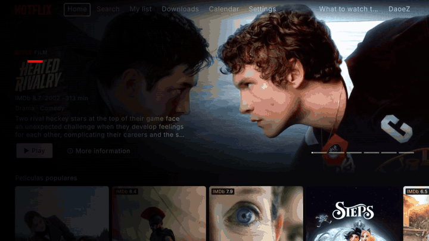
</p>

Notflix は、Nuvio のためにファンが作った表示レイヤーです。Nuvio の機能（Stremio アドオン、プロフィール、アカウントの同期、デブリッドサービス、字幕、プレーヤー）はすべてそのままに、映画のようなインターフェイスをその上に重ねます。TV ではリモコン操作向けに作られており、アニメーションするバナー、拡大して予告編を再生するカード、全画面の詳細ページを備えています。スマートフォンではタッチ操作向けに作られています。どちらでも、自動再生が再生できるソースを選んでくれます。

> [!IMPORTANT]
> Notflix は**コンテンツを一切**ホスト、インデックス、配布していません。表示するのは、あなたが設定したアドオンやサービスが返すものだけです。独立したファンプロジェクトであり、**いかなるストリーミングサービスとも提携していません**。また、Nuvio の公式リリースでもありません。

## 1.0 の新機能

- **Android TV 版がベータを卒業しました。** 動作が速くなり、並べ替えられる新しいプレーヤーのボタン、デザインを一新した設定、言語に応じたより賢い自動再生、あなたの言語のポスターと予告編が加わりました。TV でもダウンロードが使えるようになりました。
- **Android スマートフォン版アプリが登場しました。** タッチ操作向けに作られた同じ Notflix の見た目で、ダウンロード、*Send to TV*、TV アプリとの同期に対応しています。
- **iPhone** 版は後日公開予定です。

すべての変更点は [1.0 のリリースノート](https://github.com/DaoeZ/notflix/releases/latest) をご覧ください。

## スクリーンショット

### Android TV

| | |
|:---:|:---:|
| 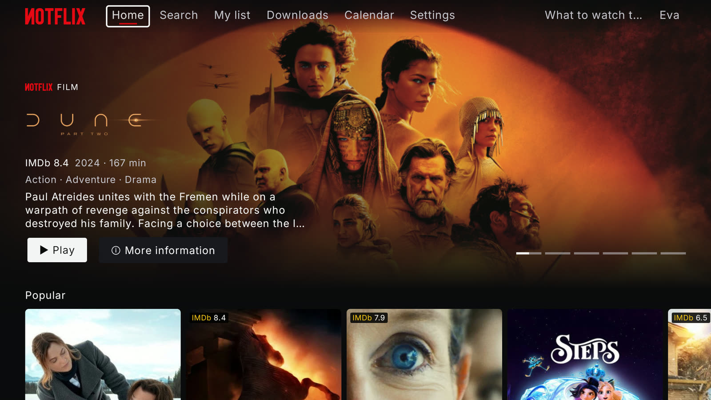 | 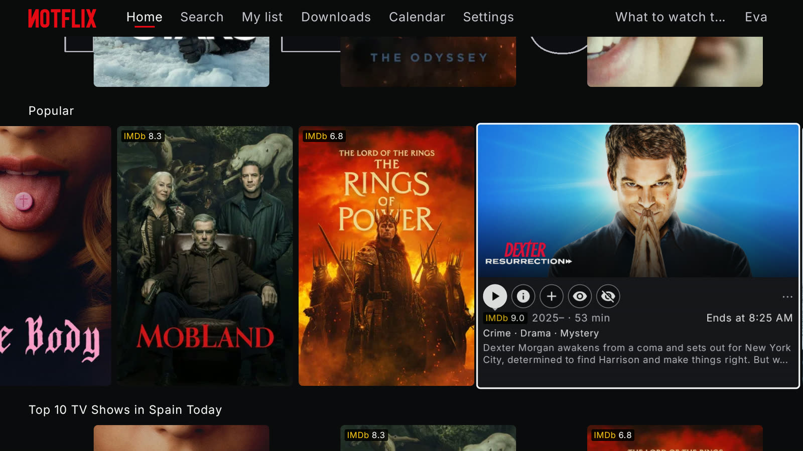 |
| ホーム | タイトルにフォーカスを合わせるとカードが開きます |
| 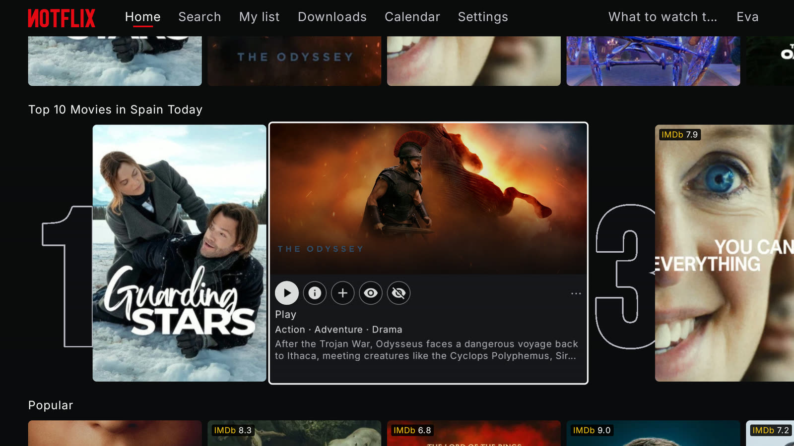 | 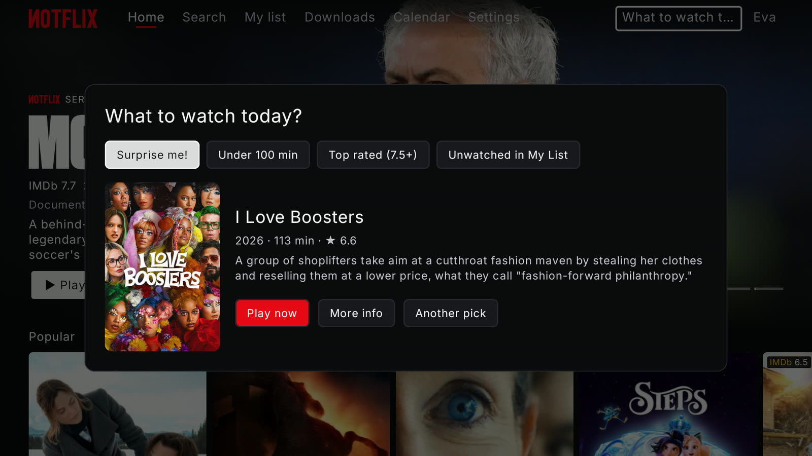 |
| 今日のあなたの国の TOP10 | 決められないときは、代わりに選んでくれます |
| 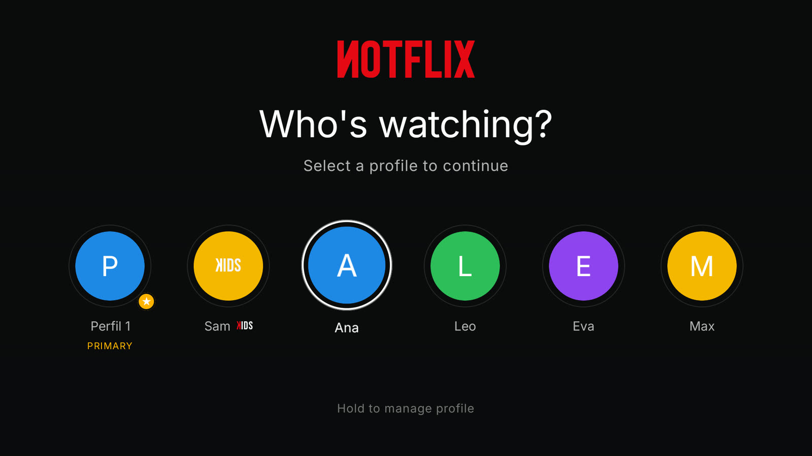 | 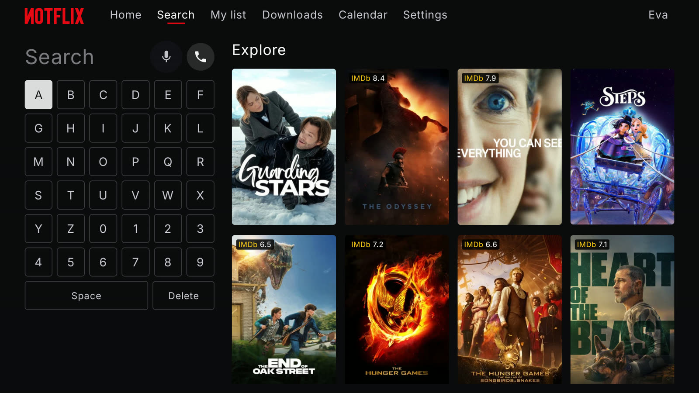 |
| キッズを含むプロフィール | 検索するか、スマートフォンで入力できます |

### Android スマートフォン

| ホーム | タイトルページ | 今日は何を見ますか？ | ダウンロード | キッズ |
|:---:|:---:|:---:|:---:|:---:|
| 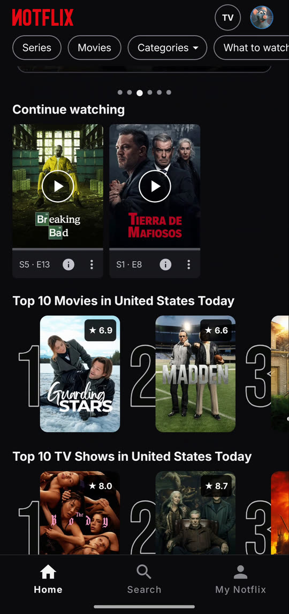 | 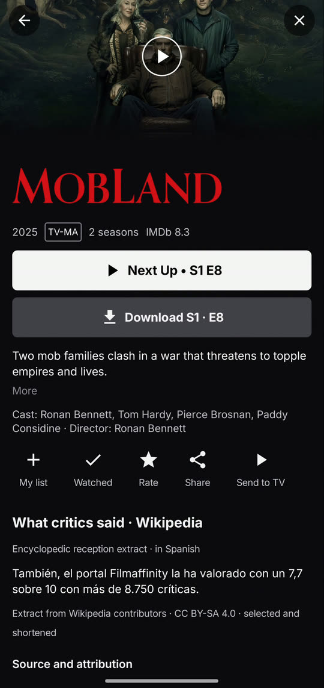 | 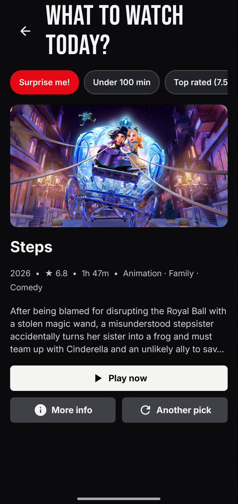 | 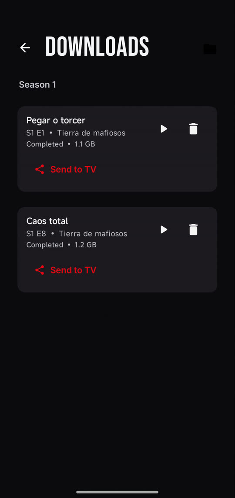 | 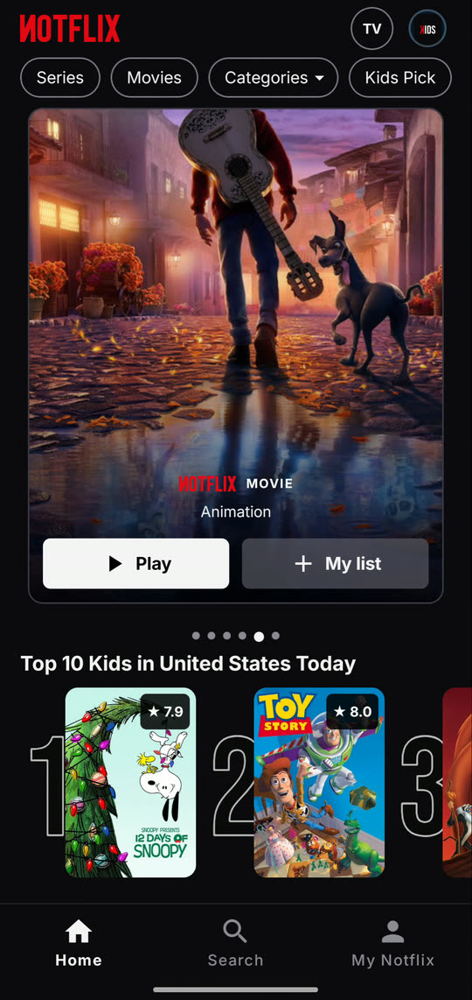 |

## 機能

### Android TV

- **ソファでくつろぐためのホーム。** タイトルのロゴ付きで切り替わるバナー、すぐに使える列（人気、新着、ジャンル、俳優、監督、スタジオ）、*今日のあなたの国の TOP10*、*マイリスト*、*〇〇を見たあなたへ*、*今週* の列、そして IMDb と TMDB のどちらの評価かが分かる評価表示を備えています。
- **今日は何を見ますか？** ホームのボタン（またはリモコンのメニューボタン）を押して、100 分未満、おやすみ前、高評価、マイリストの未視聴、アニメ、*おまかせ！* から選べます。キッズ版もあります。
- **生き生きと動くカード。** タイトルにフォーカスを合わせるとカードが拡大し、予告編を再生して、評価、公開年、上映時間、終了時刻、ジャンル、あらすじを表示します。カードから直接、再生、詳細を開く、マイリストに追加、視聴済みにする、ミュート、非表示ができます。カードのサイズと、カードが開くまでの速さを選べます。
- **全画面の詳細ページ** には、背景画像、ロゴ、キャスト、シーズン、エピソード、予告編、シーズンのリキャップがあり、*再生* の隣に *ダウンロード* ボタンもあります。
- **リモコン向けに作られたプレーヤー。** アイコンと名前付きのボタン（音声と字幕、エピソード、次のエピソード、速度、その他）、±10 秒、赤いプログレスバーを備えています。ボタンは選択・並べ替えができます。**ナイトモード** はセリフを聞き取りやすく、大きな音のシーンを穏やかにします。**スリープタイマー** は、設定した時間が経つかエピソードの終わりで停止します。ExoPlayer と mpv の両方を使えます。
- **スマートフォンをリモコンに。** 検索画面の QR コードをスキャンすると、スマートフォンから検索語を入力したり、再生を操作したり、タイトルを送ったりできます。すべて家庭内のネットワーク経由です。
- **賢い自動再生。** アドオン、画質、音声の言語の優先順位を並べ替え、画質と言語のどちらを優先するかを選べます。音声のタグは 35 言語で認識され、一致する音声トラックで再生が始まります。同じタイトルに戻ってきた場合は、最後に再生できたリンクを 7 日間再利用します。
- **家族みんなのプロフィール。** **キッズ** プロフィールには専用のホームがあり、年齢制限内のタイトルだけが表示されます。メインのプロフィールに PIN を設定していれば、その PIN なしでは誰も年齢制限を変更できません。
- **あなたの言語で。** インターフェイスは 36 言語に対応しており、タイトル、あらすじ、ポスター、予告編は TMDB を通じてアプリの言語に合わせて表示され、ない場合は英語で表示されます。
- **ダウンロード。** TV で映画やエピソードをダウンロードしたり、QR コードをスキャンしてスマートフォン版アプリから受け取ったりして、インターネットなしで視聴できます。
- **その他:** *お知らせ* 付きの今後のエピソードのカレンダー、IntroDB によるイントロのスキップ、コードによる Trakt と Simkl へのサインイン、アンビエントモード、独自のイントロとインターフェイスの効果音、アプリ内のアップデート。*設定 → 外観* から、いつでも Nuvio の元の見た目に戻せます。

### Android スマートフォン

- **タッチ操作向けに作られた Notflix の見た目。** 切り替わるバナー、TV と同じ列（あなたの国の TOP10 を含む）、*今日は何を見ますか？*、そしてロゴ、予告編、シーズン、エピソード、前のシーズンのリキャップ（シーズン 2 以降）、Wikipedia のレビューを備えたタイトルページがあります。
- 互換性のあるソースの**ダウンロード**に対応しており、シーズン全体のダウンロードもできます。*Wi-Fi only* はデフォルトでオンです。**Smart Downloads** は、ストレージの上限内で視聴済みのエピソードを削除し、次のエピソードをキューに追加します。**Send to TV** は、完了したダウンロードを TV アプリにコピーします。
- スマートフォンから使える **TV のリモコンとキーボード**。タイトルやエピソードを TV に送ることもできます。
- ラベル付きでカスタマイズできるボタン、ナイトモード、スリープタイマー、*まだ視聴中ですか？*、終了時のおすすめを備えた**プレーヤー**。
- **TV アプリと同期します。** 同じ Nuvio アカウントを使えば、プロフィール、ライブラリ、視聴の進捗、非表示にしたタイトル、年齢制限、Notflix の設定、Trakt を共有できます。
- **TV と同じルール**: キッズプロフィール、非表示にしたタイトル、優先順位に基づく自動再生、*お知らせ* 付きの公開カレンダー、アップデートごとの *新機能*。
- このリポジトリのリリースからの**アプリ内アップデート**。

## インストール

Notflix には **Android 7.0 以降** が必要です。どちらのアプリも公式の Nuvio アプリを上書きせず、並べてインストールされます。

### Android TV

Android TV、Google TV、Fire TV、ほとんどの Android ボックスに対応しています。すでに Notflix をお使いの場合は、アプリが自動でアップデートを案内します。

| お使いのデバイス | APK | Downloader のコード |
|---|---|---|
| ほとんどの TV とスティック（Xiaomi、Fire TV、Chromecast with Google TV など） | [ARM32](https://github.com/DaoeZ/notflix/releases/latest/download/Notflix-armeabi-v7a.apk) | `6378067` |
| 最近の 64 ビットのボックス（Nvidia Shield、新しい Google TV デバイスなど） | [ARM64](https://github.com/DaoeZ/notflix/releases/latest/download/Notflix-arm64-v8a.apk) | `8264266` |
| 分からない場合 | [Universal](https://github.com/DaoeZ/notflix/releases/latest/download/Notflix-universal.apk)（ダウンロードサイズが大きくなります） | `3774482` |

**Downloader アプリを使う場合:** Downloader を開き、コードを入力して APK をインストールします。TV に確認されたら、Downloader に不明なアプリのインストールを許可してください。

同じネットワーク上のコンピューターから **ADB を使う場合**:

```bash
adb connect <tv-ip-address>
adb install Notflix-armeabi-v7a.apk
```

### Android スマートフォン

スマートフォンで [最新のリリース](https://github.com/DaoeZ/notflix/releases/latest) を開き、スマートフォン用の APK をダウンロードします。ほとんどのスマートフォンでは `Notflix-Mobile-arm64.apk` が必要です。スマートフォンに確認されたら、ブラウザにアプリのインストールを許可してください。

> TV アプリはスマートフォン向けではなく、スマートフォン版アプリは TV 向けではありません。それぞれのデバイスに合ったものをインストールしてください。

## はじめに

1. QR コードをスキャンして Nuvio アカウントでサインインするか、*アカウントなしで続ける* を選びます。アカウントを使うと、アドオン、プロフィール、ライブラリ、視聴の進捗がすべてのデバイスに表示されます。Stremio のユーザーは、r/NuvioAddons と r/StremioAddons のガイドに従ってアカウントを Nuvio に移行できます。
2. 家族一人ひとりのプロフィールと、小さなお子さん向けのキッズプロフィールを作成します。
3. 任意: *設定 → 接続済みアカウント* で、コードを使って Trakt または Simkl に接続します。ここでは独自の TMDB キーを追加することもでき、組み込みのキーより優先されます。

## ソースからビルドする

JDK 21 と Android SDK が必要です（Android Studio には両方が含まれています）。

```bash
git clone https://github.com/DaoeZ/notflix.git
cd notflix
CI_USE_DEBUG_SIGNING=true ./gradlew :app:assembleFullRelease
```

APK は `app/build/outputs/apk/full/release/` に出力されます。ローカルのデバッグキーで署名されるため、公式のリリースの上にアップデートとしてインストールすることはできません。`ANDROID_HOME` が設定されていない場合は、`local.properties` に `sdk.dir=<path to the Android SDK>` を記述してください。アプリ内のアップデートを自分のフォークに向けるには、`-PnotflixGithubOwner=<owner> -PnotflixGithubRepo=<repo>` を追加します。ソースからのビルドにはサービスのキーが組み込まれていないため、アプリ内で独自の TMDB キーを入力してください。

## プライバシー

Notflix には広告、分析、トラッキングは一切ありません。アプリがどのサービスと通信し、何がデバイスに残るのかについては、[プライバシーポリシー](PRIVACY.md) をお読みください。

## フィードバック

バグを見つけた、またはアイデアがある場合は、[Issue](https://github.com/DaoeZ/notflix/issues/new/choose) を作成するか、[r/NotflixTV](https://www.reddit.com/r/NotflixTV/) に投稿してください。プルリクエストを送る前に、[CONTRIBUTING](CONTRIBUTING.md) をお読みください。

## クレジット

- **[NuvioTV](https://github.com/NuvioMedia/NuvioTV)** と **[NuvioMobile](https://github.com/NuvioMedia/NuvioMobile)**（GPL-3.0）: Notflix のベースとなっているアプリです。エンジン、アドオン、再生の機能は Nuvio によるものです。
- **Bebas Neue**（Dharma Type 作）、SIL Open Font License 1.1。
- メタデータとアートワーク: [TMDB](https://www.themoviedb.org/) と各ユーザーのアドオン。この製品は TMDB の API を使用していますが、TMDB による推奨や認定を受けたものではありません。
- 視聴履歴、スクロブル、カレンダー: [Trakt](https://trakt.tv/)。Notflix は Trakt を使用していますが、Trakt による推奨や認定を受けたものではありません。
- サードパーティに関する完全な表示は [`NOTICE.txt`](app/src/main/assets/notflix/NOTICE.txt) にあります。

## ライセンス

Nuvio と同じく、[GNU General Public License v3.0](LICENSE) です。
