<p align="center">
  
</p>

<p align="center">
  <b>A Netflix-style interface for Android TV and Android phones, built on <a href="https://github.com/NuvioMedia/NuvioTV">NuvioTV</a> and <a href="https://github.com/NuvioMedia/NuvioMobile">NuvioMobile</a>.</b>
</p>

<p align="center">
  <a href="https://github.com/DaoeZ/notflix/releases/latest"></a>
  <a href="LICENSE"></a>
  
  
</p>

<p align="center">
  <b>English</b> · <a href="README.es.md">Español</a> · <a href="README.ja.md">日本語</a>
</p>

<p align="center">
  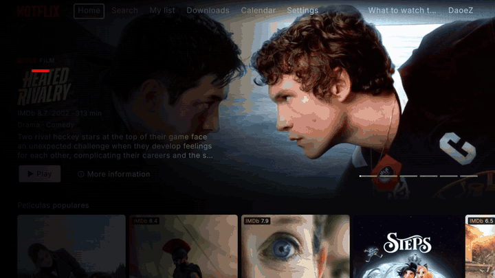
</p>

Notflix is a fan-made presentation layer for Nuvio. It keeps everything Nuvio does (Stremio addons, profiles, account sync, debrid services, subtitles, players) and puts a cinematic interface on top of it. On TV it is built for the remote: an animated banner, cards that grow and play the trailer, and full-screen details. On phones it is built for touch. Autoplay picks a working source for you on both.

> [!IMPORTANT]
> Notflix hosts, indexes and distributes **no content**. It only shows what the addons and services you set up return. It is an independent fan project, **not affiliated with any streaming service**, and not an official Nuvio release.

## What's new in 1.0.5

- **Like / Not interested** on title pages, so *For You* learns what each profile likes.
- **Theme colour** (red, blue, green, purple, orange or pink), and on TV an **interface size** setting from 60% to 130%.
- **Episode ratings for almost every show**, with SeriesGraph and TMDB as fallbacks when IMDb has none.
- **Trap videos skipped**: placeholder videos and uncached links are skipped automatically, and episodes start faster.
- **Subtitle style stays per device**, hideable Top 10 rows, add-on renaming and reorganized settings.

1.0 brought the Android phone app and took the TV app out of beta. Full list in the [release notes](https://github.com/DaoeZ/notflix/releases/latest).

## Screenshots

### Android TV

| | |
|:---:|:---:|
| 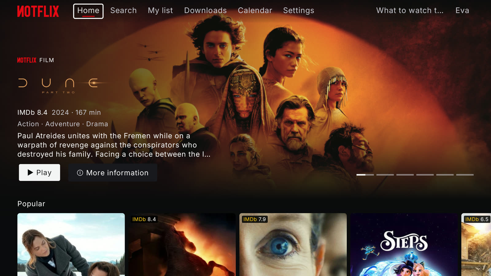 | 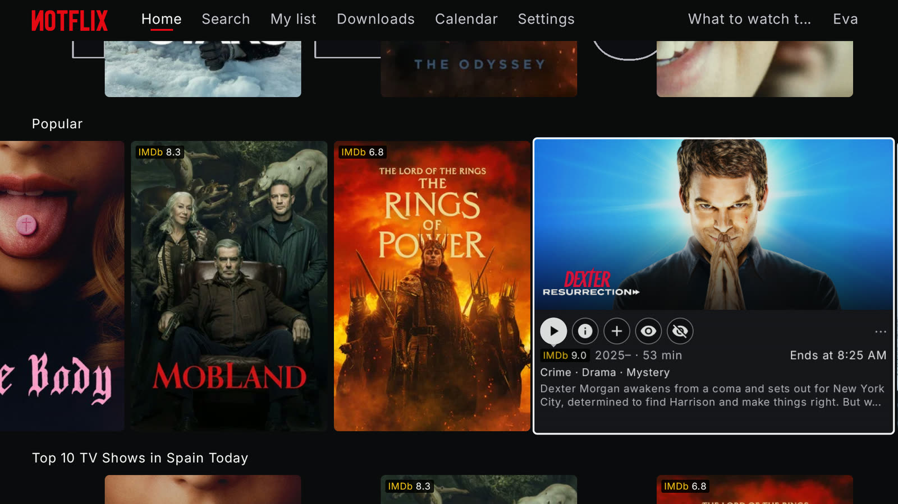 |
| Home | Rest on a title and its card opens |
| 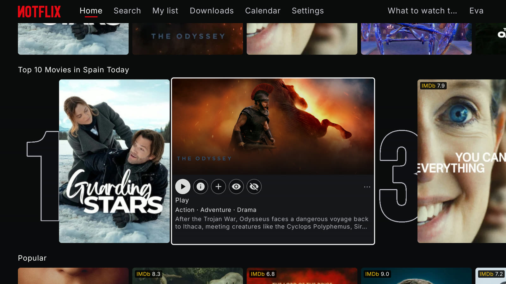 | 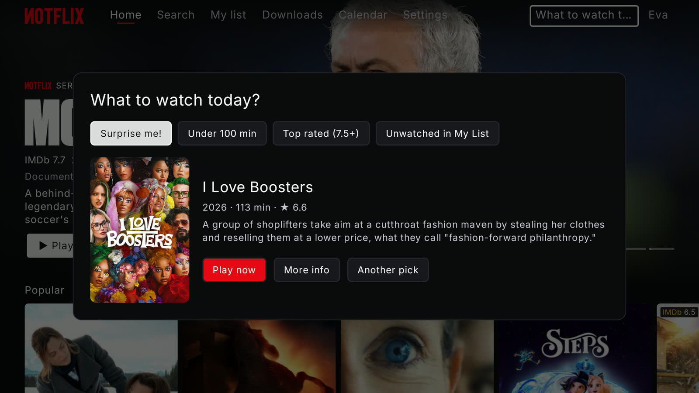 |
| Top 10 in your country today | Can't decide? It picks for you |
| 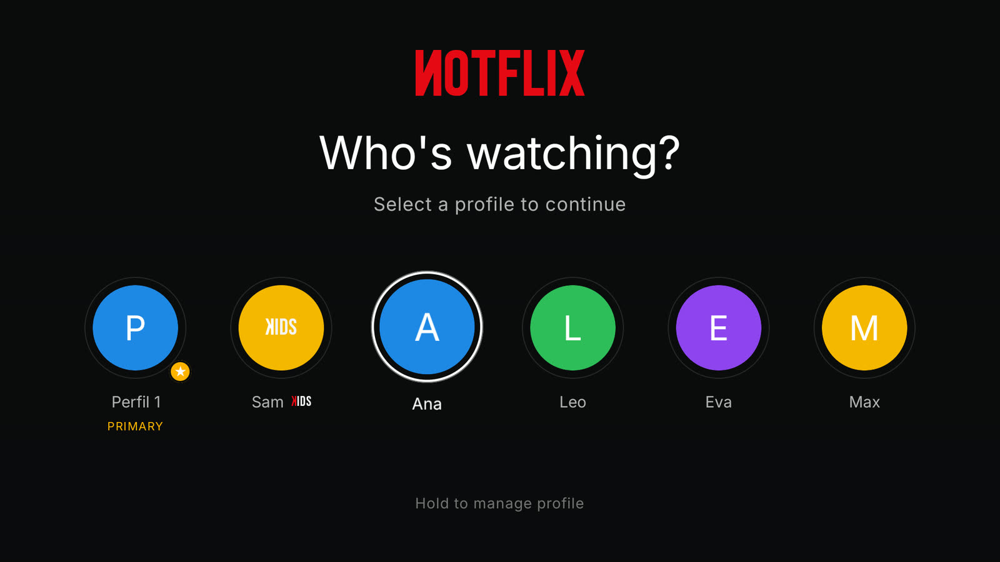 | 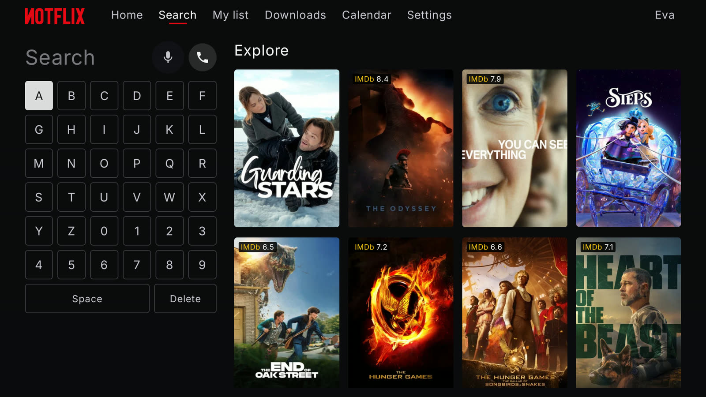 |
| Profiles, including KIDS | Search, or type it on your phone |

### Android phones

| Home | Title page | What to watch today? | Downloads | KIDS |
|:---:|:---:|:---:|:---:|:---:|
| 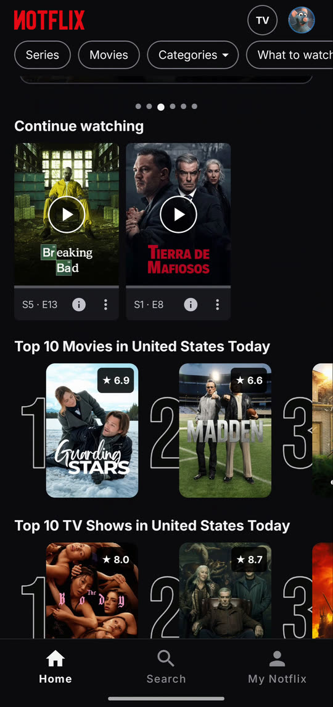 | 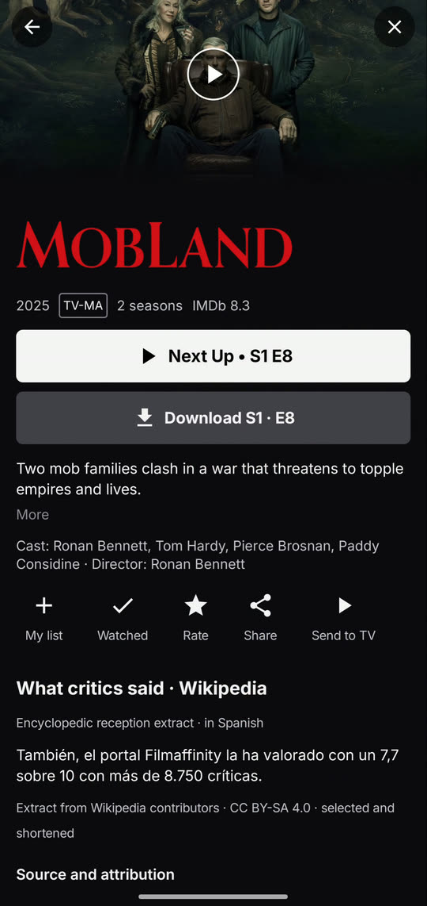 | 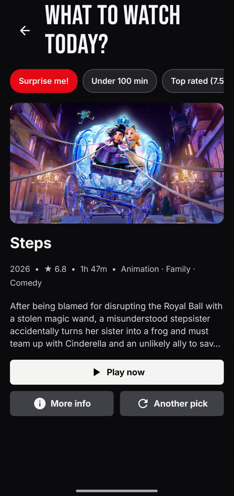 | 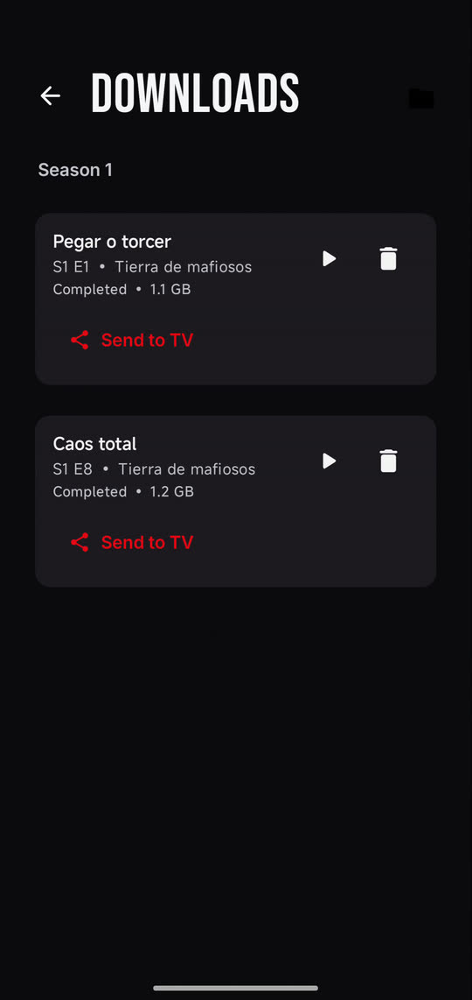 | 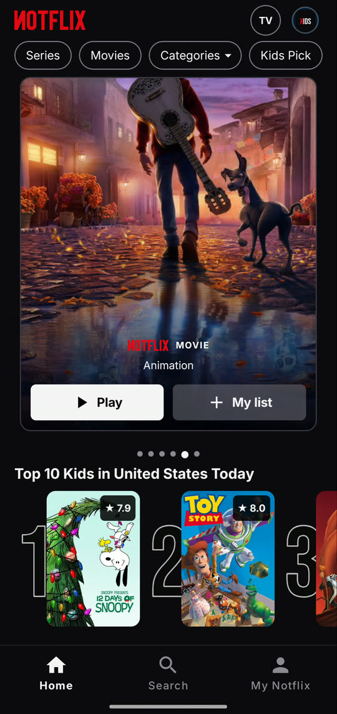 |

## Features

### Android TV

- **Home made for the couch.** A rotating banner with the title's logo, ready-made rows (popular, new, genres, actors, directors, studios), *Top 10 in your country today*, *My list*, *Because you watched*, a *This week* row and ratings that show whether they come from IMDb or TMDB.
- **What to watch today?** Press the button on Home (or Menu on the remote) and pick under 100 minutes, bedtime, top rated, unwatched in My list, animation or *Surprise me!*. There is a kids version too.
- **Cards that come alive.** Rest on a title and its card grows, plays the trailer and shows rating, year, runtime, end time, genres and synopsis. Play, open details, add to My list, mark as watched, mute or hide it right from the card. You choose the card size and how fast cards open.
- **Full-screen details** with backdrop, logo, cast, seasons, episodes, trailers and a season recap, plus a *Download* button next to *Play*.
- **Player built for the remote.** Buttons with icons and names (Audio & subtitles, Episodes, Next episode, Speed, More), ±10 s and a red progress bar. Choose and reorder the buttons. **Night mode** makes dialogue clearer and loud scenes softer, and the **sleep timer** stops after a set time or at the end of the episode. ExoPlayer and mpv are both available.
- **Your phone as a remote.** Scan the QR in Search to type searches, control playback or send a title from the phone, all over your home network.
- **Smart autoplay.** Order your addons, qualities and audio languages, and choose whether quality or language comes first. Audio tags are recognised in 35 languages, and playback starts with the matching audio track. Coming back to a title reuses the last link that worked for 7 days.
- **Profiles for the whole house.** **KIDS** profiles get their own Home and only see titles within their age limit. If the main profile has a PIN, nobody can change that limit without it.
- **Your language.** The interface comes in 36 languages, and titles, synopses, posters and trailers follow the app language through TMDB, falling back to English.
- **Downloads.** Download a movie or episode on the TV, or receive one from the phone app by scanning a QR code, then watch it without internet.
- **And more:** a calendar of upcoming episodes with *Remind me*, skip intro with IntroDB, Trakt and Simkl sign-in with a code, ambient mode, its own intro and interface sounds, and updates inside the app. You can switch back to the original Nuvio look in *Settings → Appearance* at any time.

### Android phones

- **The Notflix look, built for touch.** Rotating banner, the same rows as on TV (including Top 10 in your country), *What to watch today?*, and title pages with logo, trailer, seasons, episodes, a recap of the previous season (from season 2 on) and Wikipedia reviews.
- **Downloads** for compatible sources, including whole seasons, with *Wi-Fi only* on by default. **Smart Downloads** delete watched episodes and queue the next one within a storage limit. **Send to TV** copies a finished download to the TV app.
- **TV remote and keyboard** from the phone, and send a title or episode to the TV.
- **Player** with labelled, customisable buttons, night mode, sleep timer, *Still watching?* and recommendations at the end.
- **Syncs with the TV app.** With the same Nuvio account you share profiles, library, progress, hidden titles, age limits, Notflix settings and Trakt.
- **The same rules as the TV**: KIDS profiles, hidden titles, priority autoplay, release calendar with *Remind me*, and *What's new* after each update.
- **Updates inside the app** from this repository's releases.

## Install

Notflix needs **Android 7.0 or later**. Both apps install next to the official Nuvio apps, not over them.

### Android TV

For Android TV, Google TV, Fire TV and most Android boxes. If you already have Notflix, the app offers the update by itself.

| Your device | APK | Downloader code |
|---|---|---|
| Most TVs and sticks (Xiaomi, Fire TV, Chromecast with Google TV…) | [ARM32](https://github.com/DaoeZ/notflix/releases/latest/download/Notflix-armeabi-v7a.apk) | `6378067` |
| Recent 64-bit boxes (Nvidia Shield, newer Google TV devices…) | [ARM64](https://github.com/DaoeZ/notflix/releases/latest/download/Notflix-arm64-v8a.apk) | `8264266` |
| Not sure | [Universal](https://github.com/DaoeZ/notflix/releases/latest/download/Notflix-universal.apk) (bigger download) | `3774482` |

**With the Downloader app:** open Downloader, type the code and install the APK. Allow Downloader to install unknown apps when the TV asks.

**With ADB** from a computer on the same network:

```bash
adb connect <tv-ip-address>
adb install Notflix-armeabi-v7a.apk
```

### Android phones

Open the [latest release](https://github.com/DaoeZ/notflix/releases/latest) on your phone and download the phone APK. Most phones need `Notflix-Mobile-arm64.apk`. Allow your browser to install apps when the phone asks.

> The TV app is not made for phones, and the phone app is not made for TVs. Install the right one on each device.

## First steps

1. Sign in with a Nuvio account by scanning the QR code, or choose *Continue without account*. With an account, your addons, profiles, library and progress appear on every device. Stremio users can move their account to Nuvio with the guides on r/NuvioAddons and r/StremioAddons.
2. Create a profile for each person, and a KIDS profile for the little ones.
3. Optional: connect Trakt or Simkl with a code in *Settings → Connected accounts*. You can also add your own TMDB key there, and it takes priority over the built-in one.

## Build from source

You need a JDK 21 and the Android SDK (Android Studio includes both).

```bash
git clone https://github.com/DaoeZ/notflix.git
cd notflix
CI_USE_DEBUG_SIGNING=true ./gradlew :app:assembleFullRelease
```

The APKs are in `app/build/outputs/apk/full/release/`. They are signed with your local debug key, so they can't install as updates over the official releases. If `ANDROID_HOME` is not set, put `sdk.dir=<path to the Android SDK>` in `local.properties`. Add `-PnotflixGithubOwner=<owner> -PnotflixGithubRepo=<repo>` to point in-app updates at your own fork. Builds from source have no built-in service keys, so enter your own TMDB key inside the app.

## Privacy

Notflix has no ads, no analytics and no tracking. Read the [privacy policy](PRIVACY.md) to see which services the app talks to and what stays on your device.

## Feedback

Found a bug or have an idea? Open an [issue](https://github.com/DaoeZ/notflix/issues/new/choose) or post on [r/NotflixTV](https://www.reddit.com/r/NotflixTV/). Please read [CONTRIBUTING](CONTRIBUTING.md) before sending a pull request.

## Credits

- **[NuvioTV](https://github.com/NuvioMedia/NuvioTV)** and **[NuvioMobile](https://github.com/NuvioMedia/NuvioMobile)** (GPL-3.0): the apps Notflix is built on. The engine, addons and playback are theirs.
- **Bebas Neue** by Dharma Type, SIL Open Font License 1.1.
- Metadata and artwork: [TMDB](https://www.themoviedb.org/) and each user's addons. This product uses the TMDB API but is not endorsed or certified by TMDB.
- Watch history, scrobbling and calendar: [Trakt](https://trakt.tv/). Notflix uses Trakt but is not endorsed or certified by Trakt.
- Full third-party notices in [`NOTICE.txt`](app/src/main/assets/notflix/NOTICE.txt).

## License

[GNU General Public License v3.0](LICENSE), the same as Nuvio.
