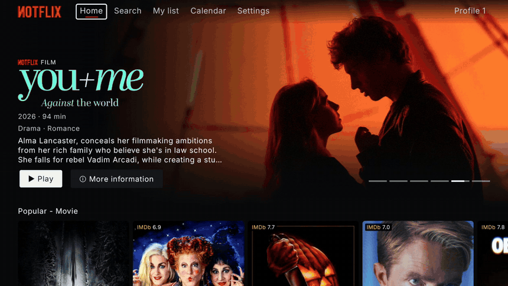
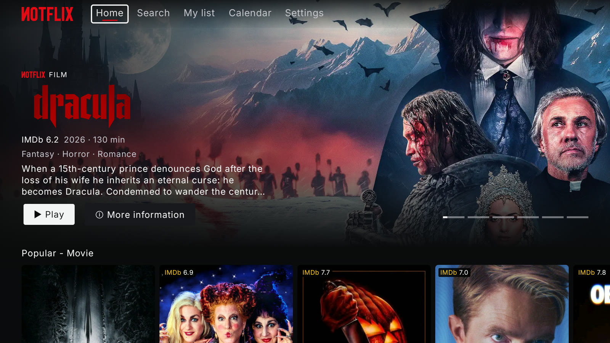
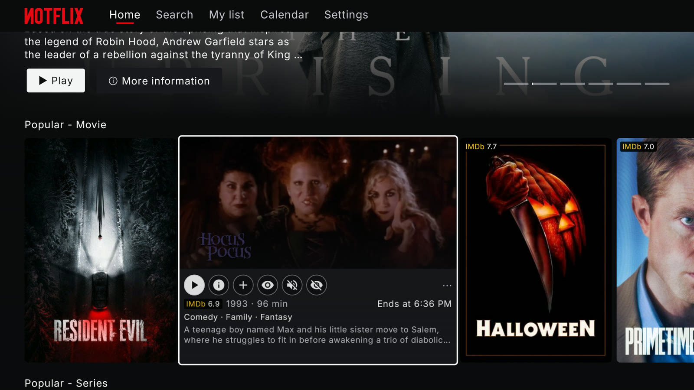
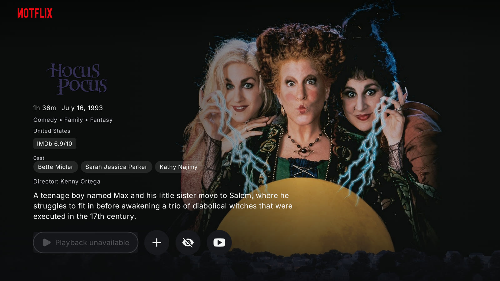
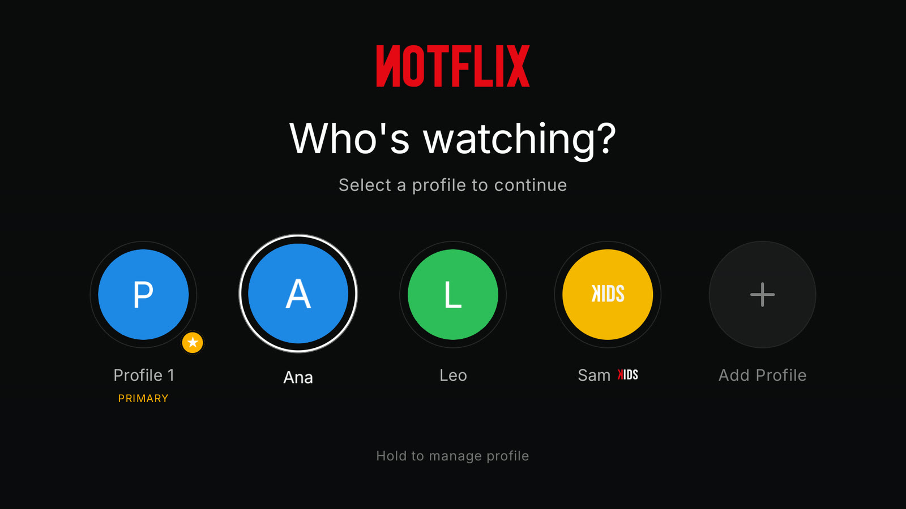
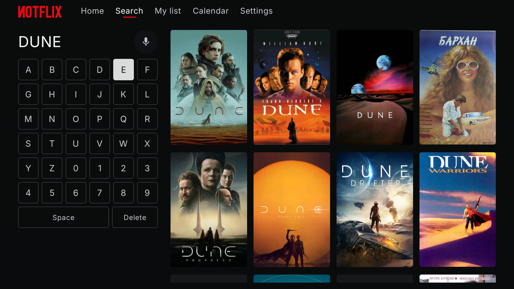
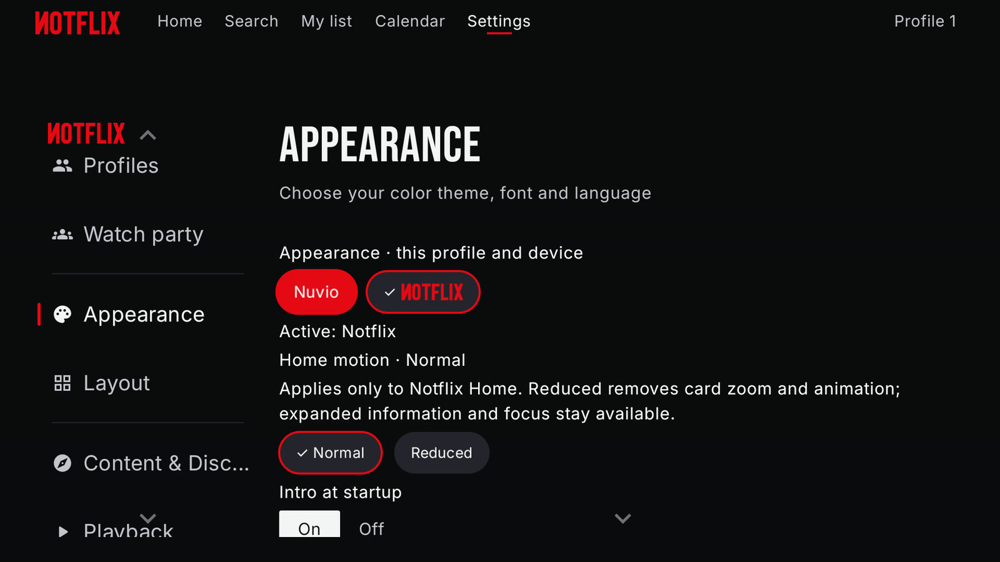

<p align="center">
  
</p>

<p align="center">
  <b>A big-screen, remote-first interface for Android TV, built on <a href="https://github.com/NuvioMedia/NuvioTV">NuvioTV</a>.</b>
</p>

<p align="center">
  <a href="https://github.com/DaoeZ/notflix/releases/latest"></a>
  <a href="LICENSE"></a>
  
</p>

<p align="center">
  <b>English</b> · <a href="README.es.md">Español</a>
</p>

<p align="center">
  
</p>

Notflix is a fan-made presentation layer for NuvioTV. It keeps everything Nuvio does (Stremio addons, profiles, account sync, debrid services, subtitles, players) and puts a cinematic, remote-friendly interface on top of it: an animated hero, cards that grow and play the trailer, full-screen details, and autoplay that picks a working source for you.

> [!IMPORTANT]
> Notflix hosts, indexes and distributes **no content**. It only shows what the addons and services you set up return. It is an independent fan project, **not affiliated with any streaming service**, and not an official NuvioTV release.

## Screenshots

| | |
|:---:|:---:|
|  |  |
| Home | Cards grow and play the trailer |
|  |  |
| Full-screen details | Profiles, including KIDS |
|  |  |
| Search built for the remote | Switch between Nuvio and Notflix at any time |

## Features

- **Home made for the couch.** An animated hero with the title's logo, ready-made rows (popular, new, genres, actors, directors, studios) and IMDb ratings on every card.
- **Cards that come alive.** Rest on a title and its card grows, plays the trailer and shows rating, year, runtime, end time, genres and synopsis. Quick actions: play, details, add to My list, mark as watched, mute.
- **Full-screen details.** Backdrop, logo, cast, director, ratings and resume where you left off.
- **Profiles for the whole house.** Create, edit and pick profiles in the Notflix style. **KIDS** profiles only see titles within their age limit; if the main profile has a PIN, nobody can change that limit without it.
- **Smart autoplay.** Set a priority list of addons and qualities, with *cached only* and *Spanish audio only* filters. Coming back to a title reuses the last link that worked for 7 days.
- **Keys from your phone.** Scan a QR code and type your TMDB key or Trakt Client ID on the phone keyboard.
- **Calendar** of upcoming episodes from your Trakt account or your shows, plus a *This week* row on Home.
- **Skip intro** with the public IntroDB service, nothing to configure.
- **Your language.** Synopses, genres, logos and trailers in the device language through TMDB, falling back to English.
- **Ambient mode** that turns the screen into a slow slideshow of artwork when you are idle.
- **Own intro and interface sounds**, both optional.
- **Updates inside the app** from this repository's releases.
- **Nuvio is still there.** Switch back to the original Nuvio look from *Settings → Appearance* whenever you like.

## Install

Notflix needs **Android 7.0 or later** (Android TV, Google TV, Fire TV and most Android boxes). It installs next to the official Nuvio app, not over it.

Download the APK from the [latest release](https://github.com/DaoeZ/notflix/releases/latest):

| Your device | APK |
|---|---|
| Most TVs and sticks (Xiaomi, Fire TV, Chromecast with Google TV…) | `armeabi-v7a` |
| Recent 64-bit boxes (Nvidia Shield, newer Google TV devices…) | `arm64-v8a` |
| Not sure | `universal` (works everywhere, bigger download) |

**With the Downloader app** (Android TV / Fire TV): open Downloader, enter `https://github.com/DaoeZ/notflix/releases/latest`, pick the APK and install it. Allow Downloader to install unknown apps when the TV asks.

**With ADB** from a computer on the same network:

```bash
adb connect <tv-ip-address>
adb install Notflix-<version>-armeabi-v7a.apk
```

## First steps

1. On the first screen, sign in to a Nuvio account to sync profiles, library and settings, or choose *Continue without account*. Then add your addons, as in Nuvio.
2. In *Settings → Integrations*, scan the QR code to add your own TMDB key (and your Trakt Client ID if you use Trakt). Skip intro works out of the box. Keys never ship inside the app; they are stored encrypted on the device.
3. Create a profile for each person, and a KIDS profile for the little ones.

## Build from source

You need a JDK 21 and the Android SDK (Android Studio includes both).

```bash
git clone https://github.com/DaoeZ/notflix.git
cd notflix
CI_USE_DEBUG_SIGNING=true ./gradlew :app:assembleFullRelease
```

The APKs are in `app/build/outputs/apk/full/release/`, signed with your local debug key, so they cannot update over the official releases. If `ANDROID_HOME` is not set, put `sdk.dir=<path to the Android SDK>` in `local.properties`. Add `-PnotflixGithubOwner=<owner> -PnotflixGithubRepo=<repo>` to point in-app updates at your own fork. Personal keys (TMDB, Trakt) do **not** go in `local.properties`: they are entered inside the app.

## Privacy

Notflix has no ads, no analytics and no tracking. Read the [privacy policy](PRIVACY.md) to see which services the app talks to and what stays on your device.

## Feedback

Found a bug or have an idea? Open an [issue](https://github.com/DaoeZ/notflix/issues/new/choose). Please read [CONTRIBUTING](CONTRIBUTING.md) before sending a pull request.

## Credits

- **[NuvioTV](https://github.com/NuvioMedia/NuvioTV)** (GPL-3.0): the app Notflix is built on. The engine, addons and playback are theirs.
- **Bebas Neue** by Dharma Type, SIL Open Font License 1.1.
- Metadata and artwork: [TMDB](https://www.themoviedb.org/) and each user's addons. This product uses the TMDB API but is not endorsed or certified by TMDB.
- Watch history, scrobbling and calendar: [Trakt](https://trakt.tv/). Notflix uses Trakt but is not endorsed or certified by Trakt.
- Full third-party notices in [`NOTICE.txt`](app/src/main/assets/notflix/NOTICE.txt).

## License

[GNU General Public License v3.0](LICENSE), the same as NuvioTV.
